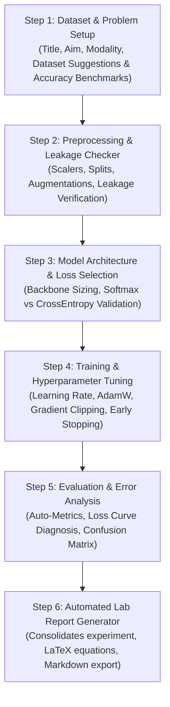

# 🧪 Autonomous AI Lab Assistant Using Deep Learning
## Complete Project Guide, Architecture, and Step-by-Step Reference Manual

> **For Students, Teammates, and Project Evaluators**  
> **Repository:** [https://github.com/Sreehasa123/autonomous-ai-lab-assistant-dl](https://github.com/Sreehasa123/autonomous-ai-lab-assistant-dl)

---

## 📑 Table of Contents
1. [Project Overview & Main Objective](#1-project-overview--main-objective)
2. [What Makes This App Different (USP & Comparisons)](#2-what-makes-this-app-different-usp--comparisons)
3. [Technology Stack: What, Why & How](#3-technology-stack-what-why--how)
4. [The 5 Top Navigation Tabs & Features](#4-the-5-top-navigation-tabs--features)
   - [Tab 1: 🧭 Step-by-Step Lab Guide](#tab-1--step-by-step-lab-guide)
   - [Tab 2: 💻 Starter Code Generator](#tab-2--starter-code-generator)
   - [Tab 3: 🛠️ Code & Error Debugger (AI Problem Solver)](#tab-3-️-code--error-debugger-ai-problem-solver)
   - [Tab 4: 📝 Automated Lab Report Generator](#tab-4--automated-lab-report-generator)
   - [Tab 5: 📚 Knowledge Base Rules Explorer](#tab-5--knowledge-base-rules-explorer)
5. [The 6 Deep Learning Lab Steps Explained](#5-the-6-deep-learning-lab-steps-explained)
6. [Comprehensive Metric Guide: All Evaluation & Diagnostic Metrics](#6-comprehensive-metric-guide-all-evaluation--diagnostic-metrics)
7. [Experiment Persistence & History System](#7-experiment-persistence--history-system)
8. [How to Run and Test the App Locally](#8-how-to-run-and-test-the-app-locally)
9. [Project Viva / Presentation Cheat Sheet](#9-project-viva--presentation-cheat-sheet)

---

## 1. Project Overview & Main Objective

### The Core Problem in Deep Learning Labs
When students and researchers perform deep learning experiments in college or research labs, they face repeated friction points:
1. **Unclear Dataset Selection**: Not knowing which dataset matches their problem statement or what accuracy is realistically achievable.
2. **Hidden Preprocessing Traps**: Beginners frequently leak data by fitting `StandardScaler` on the whole dataset before splitting into train/test, or by applying random data augmentations to test data.
3. **Catastrophic PyTorch Mismatches**: Placing an `nn.Softmax()` layer inside the forward method when using `nn.CrossEntropyLoss()`—which combines `LogSoftmax` and `NLLLoss` internally—resulting in double-softmaxed, severely flattened gradients.
4. **Training Instability**: Gradient explosions where loss suddenly becomes `NaN`, forgotten `optimizer.zero_grad()`, or learning rate misconfigurations.
5. **The Accuracy Paradox**: Evaluating an imbalanced dataset (e.g. 95% negative, 5% positive) using simple accuracy, where a model predicting 100% negatives achieves 95% accuracy while completely failing.
6. **Time-Consuming Documentation**: Writing a 10-page IEEE/academic lab report with mathematical formulas and hyperparameter tables is tedious.

### The Main Objective
> **To develop an autonomous, pedagogical, RAG-guided multi-agent AI assistant that coaches students step-by-step through their deep learning experiments—from dataset discovery with expected accuracy targets to data preprocessing, architecture design, code synthesis, real-time error debugging, experiment history storage, and publication-ready academic report generation.**

---

## 2. What Makes This App Different (USP & Comparisons)

| Dimension | Generic LLMs (ChatGPT / Claude / Copilot) | Traditional AutoML (AutoKeras, Google Cloud AutoML) | **Autonomous AI Lab Assistant (Our App)** |
|---|---|---|---|
| **Educational Focus** | Answers questions in isolation; does not preserve structured lab experiment state. | "Black-box" engine that hides code and mechanisms; the student learns nothing. | **Pedagogical Co-Pilot**: Explains *why*, warns of pitfalls, and produces verified student-facing PyTorch code. |
| **Domain-Specific RAG** | Relies purely on generic model weights; prone to hallucinating APIs or missing subtle ML traps. | None; only optimizes hyperparameters across fixed templates. | **Curated Deep Learning Rulebook**: 12+ verified domain playbooks covering data leakage, gradient clipping, Softmax bugs, and metric traps. |
| **Dataset & Accuracy Discovery** | Gives generic dataset names without realistic performance expectations. | Requires user to supply ready dataset files. | **Benchmarked Dataset Suggestions**: Suggests specific datasets from `torchvision`/Hugging Face with **achievable student accuracy ranges** (e.g. *Baseline CNN: 72% vs ResNet-18: 91%*). |
| **Evaluation Intelligence** | Often recommends just "accuracy and loss". | Reports standard auto-metrics. | **Context-Aware Metric Suite**: Automatically diagnoses task type and selects Primary vs Secondary diagnostics (Macro-F1, PR-AUC, Confusion Matrix). |
| **End-to-End Starter Code** | Gives disconnected snippets across conversational turns. | Hides code entirely inside proprietary runtimes. | **One-Click PyTorch Script**: Generates end-to-end, modular, commented PyTorch code tailored to the exact choices made. |
| **Experiment Persistence** | Chat history is ephemeral or linear; hard to iterate. | Stores models in cloud storage; opaque metadata. | **Dedicated JSON State Store**: Save, reload, and branch experiments to iterate on architectures or hyperparameters anytime. |
| **Lab Report Synthesis** | User must manually prompt and stitch responses together. | Exports raw CSV logs. | **Automated IEEE / Academic Report**: Compiles the entire experiment into a structured report with LaTeX equations and tables ready for submission. |

---

## 3. Technology Stack: What, Why & How

### 1. Streamlit (1.32+)
- **What**: Python web application framework for data science and AI.
- **Why**: Allows instant creation of clean, interactive, reactive dashboards without writing HTML/CSS/JavaScript boilerplate.
- **How**: Powers `app.py`, providing a 5-tab layout, live form inputs, dynamic metric badges, and interactive download buttons.

### 2. Google Gemini 3.8 Flash (`google-genai` SDK)
- **What**: State-of-the-art multimodal generative AI model from Google.
- **Why**: Features a 1M token context window, ultra-fast responses, robust structured JSON handling, and strong Python/PyTorch code generation.
- **How**: Used in `rag_engine.py` for dataset reasoning, starter code synthesis, error debugging, and academic report compilation.

### 3. Retrieval-Augmented Generation (RAG) Engine
- **What**: In-memory knowledge retrieval system (`knowledge_base.py`).
- **Why**: Eliminates hallucination by anchoring the LLM's responses in verified deep learning engineering best practices. Functions even in **offline mode** without an API key.
- **How**: Matches user queries using tokenized keyword search across curated deep learning rules and injects them as grounding context into prompts.

### 4. PyTorch & Torchvision (2.2+)
- **What**: The premier open-source deep learning framework used across academic research.
- **Why**: Provides transparent, pythonic tensor operations and modular `nn.Module` classes.
- **How**: Used to define reference network architectures (`BaselineNet`, `ResNet-18`), transformation pipelines, loss functions, and optimizers.

### 5. Scikit-Learn & Pandas
- **What**: Industry-standard data science and machine learning libraries.
- **Why**: Essential for train-test splitting, feature scaling, confusion matrices, and classification metrics.
- **How**: Powers dataset inspection preview, missing value analysis, and calculation code snippets in `app.py`.

### 6. Local JSON Persistence Engine
- **What**: Atomic local file storage (`experiment_storage.py`).
- **Why**: Zero-dependency local persistence that doesn't require setting up a heavy SQL or NoSQL database.
- **How**: Stores experiment state in `workspace/experiments_history.json`, allowing students to save, reload, and branch runs at any time.

---

## 4. The 5 Top Navigation Tabs & Features

```
┌────────────────────────────────────────────────────────────────────────────────────────────────────────────────────────┐
│  🧭 1. Step-by-Step Lab Guide │ 💻 2. Starter Code Generator │ 🛠️ 3. Code & Error Debugger │ 📝 4. Automated Lab Report │ 📚 5. Knowledge Base Rules   │
└────────────────────────────────────────────────────────────────────────────────────────────────────────────────────────┘
```

### Tab 1: 🧭 Step-by-Step Lab Guide
*The core interactive backbone guiding the student through all 6 experimental phases sequentially.*
- **What It Does**:
  - Acts as a real-time lab mentor.
  - Takes inputs for each step, analyzes them, checks for common pitfalls, provides dataset recommendations, and guides metric evaluation.
  - Features quick-prompt inquiry buttons (e.g. *"Should I scale before splitting?"*, *"Why is loss NaN?"*).
- **Metrics Tracked & Generated in this Tab**:
  1. **Dataset Benchmark Accuracy Range**: Indicates expected accuracy (e.g., *Baseline CNN: 72–76% vs ResNet-18: 91–94%*).
  2. **Class Distribution & Imbalance Ratio**: $\text{Ratio} = \frac{N_{\text{majority}}}{N_{\text{minority}}}$. Detects severe skew requiring class weighting.
  3. **Missing Value Ratio**: Percentage of null values per column; dictates whether to impute or drop.
  4. **Data Split Ratio**: 80% Train, 10% Validation, 10% Test allocation.
  5. **Validation Loss & Accuracy Progression**: Step-by-step recording of training and generalization dynamics.

---

### Tab 2: 💻 Starter Code Generator
*The automated synthesis engine that produces ready-to-run PyTorch scripts.*
- **What It Does**:
  - Automatically synthesizes a clean, complete, end-to-end Python script based on the exact inputs specified in Tab 1 (Title, Aim, Chosen Dataset, Model Backbone, Task Type).
  - Automatically structures data loaders, model class (`nn.Module`), loss function, optimizer with weight decay, and the complete training/evaluation loop.
  - Includes a one-click **"📥 Download Python Script (`experiment.py`)"** button.
- **Metrics & Integrity Checks Enforced in the Code**:
  1. **Logits vs Softmax Verification**: Strictly ensures raw unnormalized logits are passed to `nn.CrossEntropyLoss` (preventing double-softmax gradient decay).
  2. **Gradient Norm Bound**: Enforces `torch.nn.utils.clip_grad_norm_(max_norm=1.0)` to safeguard against exploding gradients.
  3. **Device Placement Consistency**: Ensures model and tensors are moved cleanly to `cuda` if available, falling back gracefully to `cpu`.
  4. **Phase Switching**: Enforces `model.train()` during backpropagation and `model.eval()` with `torch.no_grad()` during validation.

---

### Tab 3: 🛠️ Code & Error Debugger (AI for Solving Any Problem)
*The dedicated deep learning error diagnostic engine that fixes broken student code and terminal crashes.*
- **What It Does**:
  - Students paste their buggy PyTorch/Python code and error traceback (e.g., terminal crash logs, NaN loss, CUDA out-of-memory).
  - The assistant uses domain-specific RAG rules combined with Gemini 3.8 Flash to diagnose the problem.
  - Outputs a 4-part solution:
    1. 🔍 **Root Cause Analysis**: Plain English explanation of the failure.
    2. ⚠️ **Deep Learning Concept / Pitfall**: What conceptual mistake caused it.
    3. 🛠️ **Corrected & Verified Code**: Full drop-in replacement code.
    4. 💡 **Prevention Tip**: How to avoid the issue in the future.
- **Diagnostic Metrics & Error Signatures Handled**:
  1. **Tensor Shape & Dimension Mismatches**: Computes matrix product compatibility: $(B, C_{\text{in}}, H, W) \to (B, C_{\text{out}}, H', W')$ to fix Linear and Conv2d flatten errors.
  2. **Numerical Instability / Exploding Gradients**: Flags when gradients $\|\nabla \mathcal{L}\| \to \infty$ and loss turns to `NaN`.
  3. **CUDA Out of Memory (OOM)**: Recommends batch size halving, gradient accumulation steps, or `torch.cuda.empty_cache()`.
  4. **Device Mismatches**: Detects `RuntimeError: Expected all tensors to be on the same device` when tensors and models reside on different hardware.
  5. **Gradient Accumulation Bugs**: Identifies missing `optimizer.zero_grad()`.

---

### Tab 4: 📝 Automated Lab Report Generator
*The academic publishing engine that writes the complete laboratory submission.*
- **What It Does**:
  - Consolidates all 6 experimental steps, datasets, hyperparameters, results, and student observations into an academic IEEE/university standard report.
  - Automatically formulates mathematical equations in LaTeX (e.g., Cross-Entropy, Softmax, SGD with Momentum, AdamW).
  - Constructs clean markdown tables for hyperparameters and experimental configurations.
  - Generates analytical error diagnoses and future research directions.
  - Includes a one-click **"📥 Download Report as Markdown (.md)"** button.
- **Report Quality & Academic Metrics**:
  1. **Structural Completeness Score**: Verifies all 9 mandatory sections: Aim, Theory, Dataset, Preprocessing, Architecture, Hyperparameters, Results, Error Analysis, and Conclusion.
  2. **Mathematical Rigor**: Embeds formal mathematical definitions ($\mathcal{L}_{\text{CE}}$, $\text{F1}$, Backprop equations).
  3. **Experimental Reproducibility**: Formats exact seeds, learning rates, batch sizes, and weight decays into a reproducible table.

---

### Tab 5: 📚 Knowledge Base Rules Explorer
*The interactive domain rulebook explaining best practices and anti-patterns.*
- **What It Does**:
  - Allows students to explore the underlying RAG rules engine.
  - Includes search capability for topics like "softmax", "leakage", "nan loss", "scaling", and "imbalance".
  - Displays each rule with its **Common Pitfall**, **Recommended Practice**, and **Verified PyTorch Code Snippet**.
- **Metrics & Rule Coverage**:
  - 12+ verified domain playbooks covering the full ML/DL lifecycle.
  - Category-based scoring: `dataset_inspection`, `preprocessing`, `model_selection`, `training_debugging`, `evaluation_diagnostics`, and `lab_report_guidance`.

---

## 5. The 6 Deep Learning Lab Steps Explained



### Step 1: Dataset & Problem Setup
- **Student Input**: Experiment Title, Aim, Modality (Vision, Tabular, NLP), and Task Type.
- **Assistant Processing**: Analyzes the semantic objective and recommends candidate datasets with sources and expected benchmark accuracy ranges. One-click selection auto-populates the workspace.
- **Key Safeguard**: Warns about identifying unique ID columns or target proxies early.

### Step 2: Preprocessing & Leakage Checker
- **Student Input**: Preprocessing steps, scaling method, imputation strategy, and split ratios.
- **Assistant Processing**: Enforces the strict rule that scalers (`StandardScaler`, `MinMaxScaler`) must be fitted *only* on the training set and applied to validation/test sets to prevent data leakage. Confirms augmentations apply only to train splits.

### Step 3: Model Architecture & Loss Selection
- **Student Input**: Model choice (e.g., Custom CNN, ResNet-18, MLP) and loss function.
- **Assistant Processing**: Checks whether model depth matches dataset size. Prevents the common bug of adding `nn.Softmax()` before `nn.CrossEntropyLoss()`.

### Step 4: Training & Hyperparameter Tuning
- **Student Input**: Batch size, learning rate, optimizer (AdamW, SGD), epochs, and schedulers.
- **Assistant Processing**: Validates learning rate bounds, recommends gradient clipping (`clip_grad_norm_`) to prevent `Loss is NaN`, enforces `optimizer.zero_grad()`, and configures early stopping.

### Step 5: Evaluation & Error Analysis
- **Student Input**: Logged training/validation loss, test metrics, and student observations.
- **Assistant Processing**: Automatically computes and explains task-specific evaluation metrics (Accuracy, Macro-F1, PR-AUC, Confusion Matrix). Analyzes loss curves to diagnose **overfitting vs underfitting**.

### Step 6: Automated Lab Report Generator
- **Student Input**: Reviews completed records and clicks "Generate Full Lab Report".
- **Assistant Processing**: Synthesizes a formal IEEE/Academic lab report with LaTeX mathematical formulations, architecture tables, error analyses, and download options (.md).

---

## 6. Comprehensive Metric Guide: All Evaluation & Diagnostic Metrics

### 6.1 Primary Evaluation Metrics

| Metric | Mathematical Definition | Purpose & Lab Interpretation |
|---|---|---|
| **Accuracy** | $\text{Accuracy} = \frac{TP + TN}{TP + TN + FP + FN}$ | General benchmark for balanced classes. Unreliable on imbalanced datasets. |
| **Validation Loss** | $\mathcal{L}_{CE} = -\sum_{i=1}^C y_i \log(\hat{y}_i)$ | Primary objective function monitored during training and early stopping. A climbing validation loss with dropping training loss signals overfitting. |
| **Macro-F1 Score** | $\text{Macro-F1} = \frac{1}{C}\sum_{c=1}^C F1_c$ | Unweighted average of F1 scores across classes; vital for imbalanced data so minority classes are not ignored. |

### 6.2 Secondary & Diagnostic Metrics

| Metric | Mathematical Definition | Purpose & Lab Interpretation |
|---|---|---|
| **Precision** | $\text{Precision} = \frac{TP}{TP + FP}$ | Measures false positive penalty. Crucial when false alarms are expensive (e.g. spam detection). |
| **Recall / Sensitivity** | $\text{Recall} = \frac{TP}{TP + FN}$ | Measures false negative penalty. Crucial when missing positive cases is dangerous (e.g. disease diagnosis). |
| **Specificity** | $\text{Specificity} = \frac{TN}{TN + FP}$ | True Negative Rate. Measures how effectively the model identifies true negative cases in medical screenings. |
| **Confusion Matrix** | 2D contingency table of Actual vs Predicted classes. | Identifies exact class confusion patterns (which pairs of classes are misclassified). |
| **ROC-AUC** | Area under the Receiver Operating Characteristic curve. | Threshold-independent ranking performance ($0.5 = \text{random guessing}, 1.0 = \text{perfect ranking}$). |
| **PR-AUC (Average Precision)** | Area under the Precision-Recall curve. | Essential for extreme class imbalance (rare positive cases $<5\%$). |

### 6.3 Training Dynamics Metrics (Diagnostics)

| Phenomenon | Observable Curve Pattern | Root Cause | Solution Recommended by Assistant |
|---|---|---|---|
| **Overfitting** | Train Loss drops low; Val Loss starts increasing. | Model memorized training noise. | Add Dropout ($0.3-0.5$), L2 Weight Decay ($1e-4$), data augmentation, or early stopping. |
| **Underfitting** | Both Train Loss and Val Loss remain stubbornly high. | Model capacity is too low or learning rate is too small. | Increase model depth/width, tune learning rate, remove excessive regularization. |
| **Exploding Gradients** | Loss becomes `NaN` or inf suddenly. | Numerical instability, unbounded gradient steps. | Apply `torch.nn.utils.clip_grad_norm_`, lower learning rate, use AdamW. |
| **Class Collapse** | High Accuracy but near-zero Macro-F1. | Model predicts majority class only. | Use class-weighted CrossEntropyLoss (`weight=class_weights`) or Focal Loss. |

---

## 7. Experiment Persistence & History System

The persistence engine is implemented in `experiment_storage.py`:
- **Storage Location**: `workspace/experiments_history.json`.
- **Atomic Operations**:
  - `save_or_update_experiment()`: Persists the complete state dictionary with a unique ID and ISO timestamp.
  - `get_all_experiments()`: Reads all saved experiments sorted by last update.
  - `get_experiment_by_id()`: Retrieves an individual experiment record.
- **Why This Matters**:
  Students don't lose their experiment details when closing the browser. They can reload past experiments from the sidebar, tweak hyperparameters, re-run diagnostics, and regenerate updated lab reports whenever they want.

---

## 8. How to Run and Test the App Locally

### 1. Clone the Repository
```bash
git clone https://github.com/Sreehasa123/autonomous-ai-lab-assistant-dl.git
cd autonomous-ai-lab-assistant-dl
```

### 2. Set Up Virtual Environment
```bash
# Windows
python -m venv venv
.\venv\Scripts\activate

# macOS / Linux
python3 -m venv venv
source venv/bin/activate
```

### 3. Install Dependencies
```bash
pip install -r requirements.txt
```

### 4. Run the Streamlit Application
```bash
streamlit run app.py
```

### 5. Add Your Free API Key
- In the sidebar, paste your **Google Gemini API Key** (get a free key from [Google AI Studio](https://aistudio.google.com)).
- *Note:* The app can also operate in **Offline Mode** using the built-in curated knowledge base rules.

---

## 9. Project Viva / Presentation Cheat Sheet

**Q1: What is the main objective of this project?**  
> *"To develop an autonomous, pedagogical, RAG-guided multi-agent AI assistant that coaches students step-by-step through their deep learning experiments—from dataset discovery with expected accuracy targets to data preprocessing, architecture design, code synthesis, real-time error debugging, experiment history storage, and publication-ready academic report generation."*

**Q2: How does it differ from ChatGPT or GitHub Copilot?**  
> *"Generic chatbots provide one-off text answers without persistent lab context, lack deep learning rulebooks (and often hallucinate fatal bugs like double Softmax), don't benchmark realistic student accuracy ranges, and don't compile structured IEEE-style academic lab reports."*

**Q3: How does it differ from AutoML tools like AutoKeras?**  
> *"AutoML is a 'black box' that hides code and mechanisms from the student. Our assistant is educational: it coaches the student through each step, explains the mathematical theory, prevents silent data leakage traps, and outputs clean PyTorch code they can learn from."*

**Q4: What is the role of RAG in this system?**  
> *"The RAG engine uses an in-memory knowledge base containing 12+ verified deep learning engineering rules. It grounds the LLM (Gemini 3.8 Flash) with verified best practices, preventing hallucinations and allowing the app to offer valuable advice even when offline."*

**Q5: What are the key features available in the top navigation tabs?**  
> *"1. Step-by-Step Lab Guide (with dataset discovery and accuracy benchmarks), 2. Starter Code Generator (producing runnable PyTorch scripts), 3. Code & Error Debugger (AI problem solver for terminal crashes and tensor mismatches), 4. Automated Lab Report Generator (creating publication-ready IEEE markdown reports), and 5. Knowledge Base Rules Explorer (rulebook of DL best practices)."*
