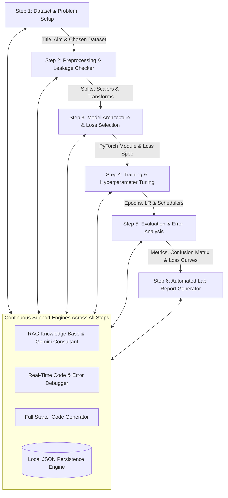

# 📘 Comprehensive Technical & Architectural Documentation: Autonomous AI Lab Assistant Using Deep Learning

---

## 1. Executive Summary & Main Objective

### 1.1 The Core Problem
In academic and research institutions, students and aspiring data scientists frequently struggle when conducting **Deep Learning (DL) laboratory experiments**. While high-level conceptual understanding may be covered in lectures, actual hands-on model engineering presents a steep barrier:
1. **Ambiguity in Problem Setup & Dataset Choice**: Students rarely know which benchmark datasets match their problem formulation or what realistic performance (accuracy/loss) to expect.
2. **Hidden Preprocessing Traps**: Beginners often make silent errors—such as applying `StandardScaler` or imputing missing data before the train/test split (data leakage), or applying data augmentations to test data.
3. **Architectural & Loss Mismatches**: A notoriously common mistake in PyTorch is appending `nn.Softmax()` to a model while using `nn.CrossEntropyLoss()` (which internally applies LogSoftmax), severely flattening gradients and killing convergence.
4. **Training Instability**: Gradient explosions (`Loss is NaN`), improper learning rates, or missing `optimizer.zero_grad()` waste hours of debugging.
5. **Evaluation Metric Traps**: Beginners often fall victim to the "Accuracy Paradox" on imbalanced datasets, reporting 95% accuracy when the model is merely guessing the majority class and failing completely on the minority class.
6. **Time-Consuming Documentation**: Writing a formal IEEE/academic lab report with mathematical formulations, LaTeX equations, and hyperparameter tables is arduous and frequently neglected.

### 1.2 The Main Objective
> **To develop an autonomous, pedagogical, RAG-powered AI Lab Assistant that actively guides students step-by-step through their end-to-end deep learning experiments—from dataset discovery and preprocessing verification to architecture selection, starter code generation, real-time error debugging, experiment persistence, and publication-ready academic report generation.**

---

## 2. What Makes This App Different from Others (Novelty & USP)

| Dimension | Generic AI Chatbots (ChatGPT / Claude / Copilot) | Pure AutoML (AutoKeras, Cloud AutoML) | **Autonomous AI Lab Assistant (Our App)** |
|---|---|---|---|
| **Educational Philosophy** | Answers questions in isolation; does not preserve structured lab experiment state. | "Black-box" engine that trains behind the scenes; the student learns nothing about the code or mechanics. | **Pedagogical Co-Pilot**: Teaches each step, explains the *why*, warns of pitfalls, and produces student-facing code. |
| **Domain-Specific RAG** | Relies solely on parametric weights; prone to hallucinating API signatures or subtle ML bugs. | None; only optimizes hyperparameters across fixed templates. | **Curated DL Knowledge Base**: 12+ verified domain playbooks covering data leakage, gradient clipping, Softmax traps, and metric rules. |
| **Dataset & Accuracy Discovery** | Gives general dataset names without realistic performance benchmarks. | Requires user to supply ready dataset files. | **Benchmarked Dataset Suggestions**: Suggests specific datasets from `torchvision`/Hugging Face with **achievable student accuracy ranges** (e.g. *Baseline CNN: 72% vs ResNet-18: 91%*). |
| **Evaluation Intelligence** | Often recommends just "accuracy and loss". | Reports standard auto-metrics. | **Context-Aware Metric Suite**: Automatically diagnoses task type and selects Primary vs Secondary diagnostics (Macro-F1, PR-AUC, Confusion Matrix). |
| **End-to-End Starter Code** | Gives disconnected snippets across conversational turns. | Hides code entirely inside proprietary runtimes. | **One-Click PyTorch Script**: Generates end-to-end, modular, commented PyTorch code tailored to the exact choices made. |
| **Experiment Persistence** | Chat history is ephemeral or linear; hard to iterate. | Stores models in cloud storage; opaque metadata. | **Dedicated JSON State Store**: Save, reload, and branch experiments to iterate on architectures or hyperparameters anytime. |
| **Lab Report Synthesis** | User must manually prompt and stitch responses together. | Exports raw CSV logs. | **Automated IEEE / Academic Report**: Compiles the entire experiment into a structured report with LaTeX equations and tables ready for submission. |

---

## 3. Technology Stack & Architectural Rationale

### 3.1 Technology Stack Matrix

| Layer / Component | Technology Used | Why We Used It | How It Is Implemented |
|---|---|---|---|
| **Frontend UI / Dashboard** | **Streamlit** (1.32+) | Python-native, reactive, clean component layout with tabs, cards, and zero JavaScript boilerplate. | `app.py`: Implements a multi-tab interface with sidebar controls, real-time reactive re-rendering, and badge components. |
| **Generative Intelligence** | **Google Gemini 3.8 Flash** (`google-genai` SDK) | 1M token context window, ultra-low latency, superior structured JSON output handling, and strong code synthesis capabilities. | `rag_engine.py`: Uses `client.models.generate_content(model="gemini-3.8-flash")` for reasoning, suggestions, debugging, and report writing. |
| **Knowledge Engine (RAG)** | **Curated In-Memory Knowledge Base + Semantic Matcher** | Guarantees deterministic, verified DL best practices without hallucination. Works offline even without an internet/API connection. | `knowledge_base.py`: Tokenized query matching with weighted title and category scoring over curated deep learning rules. |
| **Deep Learning Framework** | **PyTorch & Torchvision** (2.2+) | Industry standard for academic research and education; modular `nn.Module`, explicit tensor ops, and rich pre-trained model repositories. | Referenced in prompts, code generators, and knowledge base snippets (`BaselineNet`, `ResNet-18`, `transforms.Compose`). |
| **Evaluation & Math** | **Scikit-Learn, NumPy, Pandas** | Gold standard for validation metrics, confusion matrices, classification reports, and dataset profiling. | Used for dataset inspection preview, metric computation snippets, and statistical evaluations. |
| **Persistence Layer** | **Custom JSON Storage Engine** | Lightweight, zero-dependency, local file storage that allows full revision history without database setup overhead. | `experiment_storage.py`: Handles atomic reading, writing, and indexing of experiments to `workspace/experiments_history.json`. |
| **Safety & Sandbox** | **Python Subprocess Isolation** | Prevents arbitrary crashes from student scripts affecting the assistant daemon. | `core/sandbox.py`: Subprocess runner with execution timeouts and stdout/stderr capture. |

---

## 4. Detailed Step-by-Step Workflow Explanation

The app breaks down deep learning experiments into **six structured milestones**:

### 4.1 Step 1: Dataset & Problem Setup
- **What the Student Does**: Inputs the Experiment Title, Aim/Objective, Modality (Vision, Tabular, Text), and Task Type.
- **What the Assistant Does**:
  1. Activates `suggest_datasets()`: Analyzes the semantic meaning of the aim and suggests 3–4 candidate datasets (e.g., CIFAR-10, Fashion-MNIST, Breast Cancer Wisconsin, California Housing).
  2. Surfaces **Expected Accuracy Levels**: Tells the student what baseline and advanced models achieve so they have realistic targets.
  3. Provides a **"Use this Dataset"** button that auto-populates the experiment's metadata and recommended architecture with one click.
  4. Warns about early data leakage hazards (e.g. accidentally keeping unique ID columns in the feature matrix).

### 4.2 Step 2: Preprocessing & Leakage Checker
- **What the Student Does**: Defines their data transformation pipeline, missing value imputation strategy, and train/val/test split ratios. (Optionally uploads a CSV for instant preview).
- **What the Assistant Does**:
  1. Enforces **Feature Scaling Rules**: Verifies that `StandardScaler` / `MinMaxScaler` is fit *only* on the training partition and applied to validation/test partitions.
  2. Enforces **Augmentation Safety**: Ensures that vision augmentations (RandomCrop, HorizontalFlip, ColorJitter) are applied exclusively to training data and never to validation/test data.

### 4.3 Step 3: Model Architecture & Loss Selection
- **What the Student Does**: Selects their model architecture (e.g., ResNet-18, Custom CNN, MLP) and loss function.
- **What the Assistant Does**:
  1. **Architecture Sizing**: Evaluates whether the chosen model matches the dataset scale (e.g., discourages training a Vision Transformer from scratch on a small dataset with <50k images).
  2. **Softmax / CrossEntropy Validation**: Warns against the classic PyTorch bug of putting `nn.Softmax` in the model forward method while using `nn.CrossEntropyLoss`.
  3. Prepares the architecture parameter table for report generation.

### 4.4 Step 4: Training & Hyperparameter Tuning
- **What the Student Does**: Records batch size, learning rate, optimizer (e.g., AdamW, SGD), epoch count, and learning rate scheduler.
- **What the Assistant Does**:
  1. Advises on safe learning rates (e.g., `1e-3` or `3e-4` for AdamW).
  2. Recommends **Gradient Clipping** (`torch.nn.utils.clip_grad_norm_`) to prevent `Loss is NaN` crashes caused by exploding gradients.
  3. Provides code patterns for early stopping and `ReduceLROnPlateau` or `CosineAnnealingLR`.
  4. Reminds the student to always call `optimizer.zero_grad()` before `loss.backward()`.

### 4.5 Step 5: Evaluation & Error Analysis
- **What the Student Does**: Evaluates the trained model on test data and logs results and observations.
- **What the Assistant Does**:
  1. Automatically runs `recommend_evaluation_metrics()`: Generates the mandatory primary and secondary diagnostic metrics tailored to the problem.
  2. Provides turnkey `scikit-learn` code to compute accuracy, precision, recall, macro-F1, and normalized confusion matrices.
  3. Guides **Loss Curve Diagnosis**: Teaches the student how to differentiate between **overfitting** (training loss drops while validation loss climbs) and **underfitting** (both losses remain stubbornly high).

### 4.6 Step 6: Automated Lab Report Generator
- **What the Student Does**: Reviews their experiment records and clicks **"Generate Full Lab Report"**.
- **What the Assistant Does**:
  1. Consolidates all 6 steps into an academic IEEE-style laboratory report.
  2. Formulates the theoretical foundation, including LaTeX equations for loss functions (e.g., Cross-Entropy, MSE) and activation functions.
  3. Organizes experimental configuration into a markdown table.
  4. Synthesizes an analytical conclusion, limitations, and future improvements.
  5. Provides a one-click **"Download Report as Markdown (.md)"** button.

---

## 5. Comprehensive Guide to Evaluation Metrics

The app automatically categorizes and recommends evaluation metrics based on task characteristics:

### 5.1 Primary Metrics

| Metric | Mathematical Definition | When & Why to Use It | How to Interpret in Lab |
|---|---|---|---|
| **Accuracy** | $\text{Accuracy} = \frac{TP + TN}{TP + TN + FP + FN}$ | General performance benchmark for balanced datasets. | Measures overall percentage of correct predictions. Misleading if classes are imbalanced. |
| **Validation Loss (Cross-Entropy / MSE)** | $\mathcal{L}_{CE} = -\sum_{i=1}^C y_i \log(\hat{y}_i)$ | Primary objective function monitored during training and early stopping. | Lower is better. A rising validation loss while training loss decreases is the signature of overfitting. |
| **Macro-F1 Score** | $\text{Macro-F1} = \frac{1}{C}\sum_{c=1}^C F1_c$ | Essential for multi-class and imbalanced classification. | Calculates the unweighted mean of F1 scores across all classes. Penalizes models that fail on rare minority classes. |

### 5.2 Secondary & Diagnostic Metrics

| Metric | Mathematical Definition | When & Why to Use It | How to Interpret in Lab |
|---|---|---|---|
| **Precision (Positive Predictive Value)** | $\text{Precision} = \frac{TP}{TP + FP}$ | When the cost of False Positives is severe (e.g., spam filtering). | "Out of all instances the model predicted positive, how many were actually positive?" |
| **Recall / Sensitivity** | $\text{Recall} = \frac{TP}{TP + FN}$ | When the cost of False Negatives is critical (e.g., cancer/disease detection). | "Out of all actual positive cases, how many did the model correctly identify?" |
| **Specificity (True Negative Rate)** | $\text{Specificity} = \frac{TN}{TN + FP}$ | Clinical diagnostics, fraud screening. | Measures how effectively the model identifies true negative cases. |
| **Confusion Matrix** | 2D contingency table of Actual vs. Predicted classes. | Error analysis and failure mode detection. | Highlights which specific pairs of classes are being confused (e.g., Dog mistaken for Cat). |
| **ROC-AUC** | Area under the Receiver Operating Characteristic curve. | Ranking quality and threshold-independent performance. | $0.5 = \text{random guessing}$, $1.0 = \text{perfect ranking}$. Insensitive to class prevalence. |
| **PR-AUC (Average Precision)** | Area under the Precision-Recall curve. | Highly skewed, sparse positive datasets (e.g. rare anomaly detection). | Much more informative than ROC-AUC when positive cases make up $<5\%$ of samples. |

### 5.3 Training Dynamics Metrics

| Phenomenon | Observable Metric Pattern | Root Cause | Solution Recommended by Assistant |
|---|---|---|---|
| **Overfitting** | Train Loss $\ll$ Val Loss; Val Loss starts increasing. | Model memorized training noise. | Add Dropout ($0.3-0.5$), L2 Weight Decay ($1e-4$), data augmentation, or early stopping. |
| **Underfitting** | Both Train Loss and Val Loss remain high. | Model capacity is too low or learning rate is too small. | Increase model depth/width, tune learning rate, remove excessive regularization. |
| **Exploding Gradients** | Loss becomes `NaN` or inf suddenly. | Numerical instability, unbounded gradient steps. | Apply `torch.nn.utils.clip_grad_norm_`, lower learning rate, use AdamW. |
| **Class Collapse** | High Accuracy but near-zero Macro-F1. | Model predicts majority class only. | Use class-weighted CrossEntropyLoss (`weight=class_weights`) or Focal Loss. |

---

## 6. Real-Time Starter Code Generator & Error Debugger

### 6.1 Starter Code Generator
The assistant doesn't just explain concepts—it writes the entire foundational script:
- Automatic dataset loaders (`torchvision.datasets` or `DataLoader`).
- Transformation pipelines with distinct train vs validation transforms.
- Clean `nn.Module` definition with parameterizable layers and no redundant Softmax.
- Device placement (`cuda` vs `cpu`).
- Complete training loop with step loss logging, gradient clipping, optimizer stepping, and validation accuracy evaluation.
- Ready to run directly via terminal or download as `experiment.py`.

### 6.2 Code & Error Debugger
When students encounter runtime crashes, they paste their snippet and traceback into the debugger tab:
- **Root Cause Identification**: Diagnoses tensor dimension mismatches (e.g., `Expected 4-dimensional input for 4-dimensional weight [64, 3, 3, 3], but got 3-dimensional input of size [3, 32, 32]`), missing `.to(device)` mismatches, missing zero_grad bugs, or gradient dimension problems.
- **Conceptual Explanation**: Explains why the bug happened in beginner-friendly terms.
- **Drop-In Replacement Code**: Gives verified, fully commented replacement code.
- **Prevention Best Practices**: Provides preventive advice to reinforce learning.

---

## 7. Experiment Persistence Engine

Located in [`experiment_storage.py`](file:///c:/Users/gnana/Downloads/IDP/experiment_storage.py):
- Persists all experiment inputs, chosen datasets, architectures, hyperparameters, logged results, and generated reports in `workspace/experiments_history.json`.
- Features:
  - **Save Progress**: Atomically saves current progress with unique IDs and timestamps.
  - **Load Experiment**: Dropdown selector lets users switch between previous experiments to compare architectures or refine reports.
  - **Branch / Reset**: Easily start a new experiment without losing previous work.

---

## 8. Summary for Project Viva / Presentation

If asked to summarize the project in one slide or elevator pitch:

> *"The Autonomous AI Lab Assistant is an intelligent, RAG-guided deep learning laboratory companion that bridges the gap between theoretical deep learning education and practical experimentation. By combining a curated domain knowledge base with Google Gemini 3.8 Flash, the app guides students through the complete experiment lifecycle—recommending benchmarked datasets with expected accuracies, verifying data pipelines against leakage, preventing subtle PyTorch bugs, generating starter code, debugging errors, storing experiment iterations, and compiling publication-grade IEEE lab reports at the click of a button."*
