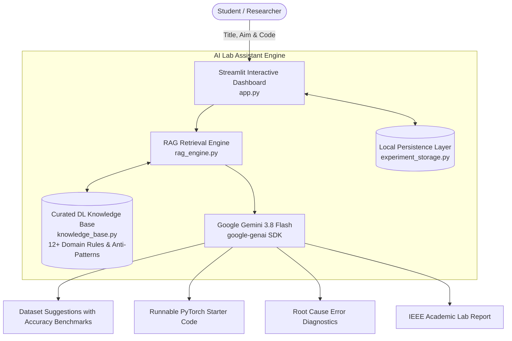

# 🧪 Autonomous AI Lab Assistant Using Deep Learning

[](https://www.python.org/)
[](https://pytorch.org/)
[](https://streamlit.io/)
[](https://aistudio.google.com/)
[](LICENSE)

> **Autonomous AI Lab Assistant** is an intelligent, RAG-guided multi-step laboratory assistant designed to empower students and researchers throughout the complete deep learning lifecycle—from problem formulation and automated dataset recommendation to preprocessing, model architecture design, code synthesis, real-time error debugging, and publication-ready lab report generation.

---

## 📌 Problem Statement & Motivation

In deep learning education and research, beginners frequently encounter bottlenecks in:
1. **Dataset Selection & Profiling**: Finding suitable datasets matching their problem and knowing what accuracy benchmarks are realistically achievable.
2. **Data Leakage & Preprocessing Traps**: Applying scalers/imputers before splitting or augmenting test data.
3. **Architecture & Loss Pitfalls**: Selecting inappropriate backbones (e.g., Vision Transformers on tiny datasets) or catastrophic bugs like double-applying `nn.Softmax` before `nn.CrossEntropyLoss`.
4. **Training Dynamics & Debugging**: Diagnosing exploding gradients (`NaN` loss), vanishing gradients, learning rate misconfigurations, or CUDA memory errors.
5. **Evaluation Metric Traps**: Relying on raw accuracy on imbalanced datasets rather than Macro-F1, PR-AUC, and confusion matrices.
6. **Documentation & Reporting**: Manually formatting IEEE-style experimental reports with math formulations and hyperparameter tables.

The **Autonomous AI Lab Assistant** solves these pain points through a unified, interactive workspace backed by a curated deep learning knowledge base and Google Gemini 3.8 Flash.

---

## 🌟 Key Features

### 1. 🔍 Intelligent Dataset Discovery & Benchmark Accuracies
- Input your **Experiment Title** and **Aim**.
- The assistant suggests suitable benchmark datasets (from `torchvision`, Hugging Face, Kaggle, UCI ML) complete with:
  - Dataset source and class breakdown.
  - **Expected Student Benchmark Accuracy** (e.g., *Basic CNN: 70–75% | ResNet-18: 91–94% | SOTA: 96%+*).
  - One-click dataset selection that auto-fills your experimental pipeline.

### 2. ⚡ Automatic Evaluation Metrics Recommendation
- Dynamically configures the necessary **Primary Metrics** (Accuracy, Macro-F1, Loss) and **Secondary Diagnostics** (PR-AUC, Confusion Matrix, Specificity).
- Explains *why* those metrics are required for your specific task (e.g., avoiding the accuracy paradox on imbalanced classes).
- Provides copyable `scikit-learn` / `PyTorch` calculation snippets.

### 3. 💻 End-to-End Starter Code Synthesis
- Generates clean, modular, and fully runnable PyTorch scripts tailored specifically to your chosen dataset, model architecture, and loss function.
- Includes data augmentation, model definition, training loop with gradient clipping, and validation metrics computation.
- One-click script download as `experiment.py`.

### 4. 🛠️ Real-Time Code & Error Debugger
- Paste buggy PyTorch/Python code and runtime tracebacks (e.g., shape mismatches, exploding gradients, CUDA OOM).
- Performs **Root Cause Analysis**, explains the underlying deep learning concept, and provides verified replacement code.

### 5. 💾 Experiment Persistence & History Management
- Automatically saves experiment state to `workspace/experiments_history.json`.
- Allows students to load any previous run, tweak hyperparameters, re-evaluate alternative architectures, and track iterative progress.

### 6. 📝 One-Click Academic Lab Report Generator
- Compiles all recorded experimental details into a formal, publication-ready **IEEE / Academic Lab Report** formatted in Markdown with:
  - Aim and problem formulation.
  - Theoretical background with LaTeX loss and activation formulas.
  - Dataset description and preprocessing safeguards.
  - Model architecture specifications and hyperparameter table.
  - Results discussion, error analysis, and conclusion.
  - One-click download as `.md`.

---

## 🏛️ System Architecture



---

## 📂 Repository Structure

```text
├── app.py                     # Main interactive Streamlit application
├── rag_engine.py              # RAG engine and Google Gemini API integration
├── knowledge_base.py          # Curated deep learning rules, pitfalls, and code patterns
├── experiment_storage.py      # Local JSON persistence and experiment manager
├── main.py                    # CLI workflow runner
├── core/
│   ├── config.py              # System and hardware configuration
│   ├── state.py               # Strongly-typed Pydantic schemas & state models
│   └── sandbox.py             # Safe Python script execution sandbox
├── agents/
│   └── base_agent.py          # Abstract base agent interface
├── workspace/
│   ├── datasets/              # Local datasets directory
│   ├── experiments/           # Checkpoints, figures, and artifacts
│   ├── scripts/               # Synthesized PyTorch scripts
│   └── experiments_history.json # Saved experiment records
├── requirements.txt           # Project dependencies
└── README.md                  # Comprehensive project documentation
```

---

## 🚀 Quickstart Guide

### 1. Clone the Repository
```bash
git clone https://github.com/Sreehasa123/autonomous-ai-lab-assistant-dl.git
cd autonomous-ai-lab-assistant-dl
```

### 2. Create and Activate a Virtual Environment
```bash
# Windows
python -m venv venv
.\venv\Scripts\activate

# Linux / macOS
python3 -m venv venv
source venv/bin/activate
```

### 3. Install Dependencies
```bash
pip install -r requirements.txt
```

### 4. Launch the Application
```bash
streamlit run app.py
```

### 5. Configure Your API Key
- Enter your **Google Gemini API Key** directly in the sidebar inside the app (or set `export GEMINI_API_KEY="your-key"`).
- Get a free API key at [Google AI Studio](https://aistudio.google.com).
- *Note:* The application can also operate in **Offline Mode** using the built-in curated knowledge base rules.

---

## 🧪 Supported Deep Learning Workflows

| Step | Focus Area | Key Checks & Assistant Support |
|---|---|---|
| **Step 1** | Problem Formulation & Dataset | Dataset suggestions, accuracy benchmarks, modality detection |
| **Step 2** | Preprocessing & Splitting | Imputation order, feature scaling, preventing data leakage |
| **Step 3** | Architecture & Loss Selection | ResNet vs ViT vs MLP, logits verification for CrossEntropyLoss |
| **Step 4** | Training & Optimization | Learning rate schedules, gradient clipping, AdamW, early stopping |
| **Step 5** | Evaluation & Diagnostics | Confusion matrices, Macro-F1, overfit vs underfit curve diagnosis |
| **Step 6** | Lab Report Compilation | Academic lab report synthesis with mathematical formulas and tables |

---

## 📄 License

This project is open-source and available under the [MIT License](LICENSE).
